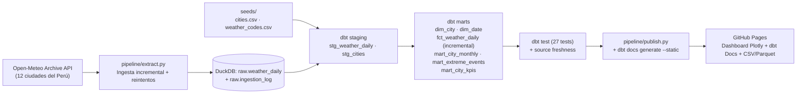

# 🌦️ Data Engineering Pipeline con Python, dbt y DuckDB

**Actividad Grupal 01-U2 – Inteligencia de Negocios (Data Engineering)**

Solución **ELT (Extract, Load, Transform)** de punta a punta, **sin AWS**, que extrae datos climáticos diarios reales de **12 ciudades del Perú** (Costa, Sierra y Selva) desde la API de **Open-Meteo**, los carga de forma **incremental e idempotente** en **DuckDB**, los transforma y valida con **dbt (`dbt-duckdb`)** aplicando **27 pruebas de calidad de datos**, y publica automáticamente un **dashboard interactivo + documentación de linaje de dbt + datasets en CSV/Parquet** en **GitHub Pages** mediante **GitHub Actions**.

- 🌐 **Dashboard en vivo:** https://victorplatero.github.io/Data-Enginnering/
- 📚 **Documentación y DAG de dbt:** https://victorplatero.github.io/Data-Enginnering/docs/
- 📝 **Artículo (Dev.to):** [docs/articulo_devto.md](docs/articulo_devto.md)
- 🎬 **Guion del video (≤ 5 min):** [docs/guion_video.md](docs/guion_video.md)

## Arquitectura



## Capas del modelo de datos (dbt)

| Capa | Objeto | Materialización | Descripción |
|---|---|---|---|
| `raw` | `raw.weather_daily`, `raw.ingestion_log` | Tabla (Python) | Datos crudos por ciudad y día + bitácora de corridas |
| `seeds` | `cities`, `weather_codes` | Seed (`CSV`) | Catálogo de 12 ciudades del Perú y códigos WMO |
| `staging` | `stg_weather_daily`, `stg_cities` | Vista | Limpieza, renombrado y estandarización de unidades |
| `marts` | `dim_city`, `dim_date` | Tabla | Dimensiones conformadas (incluye estación del hemisferio sur) |
| `marts` | `fct_weather_daily` | **Incremental** (`delete+insert`) | Hecho diario enriquecido con categorías térmicas y banderas de eventos |
| `marts` | `mart_city_monthly` | Tabla | Resumen mensual por ciudad (temperatura, lluvia, heladas, días cálidos) |
| `marts` | `mart_extreme_events` | Tabla | Lluvias intensas (≥20 mm), calor (≥30 °C), heladas (≤0 °C) y ráfagas (≥60 km/h) |
| `marts` | `mart_city_kpis` | Tabla | KPIs de los últimos 30 días y anomalía térmica frente al histórico |

## Estructura del repositorio

```
├── .github/workflows/pipeline.yml  # Orquestación CI/CD + cron diario + deploy a GitHub Pages
├── dbt_project.yml                 # Configuración del proyecto dbt
├── profiles.yml                    # Perfil de conexión dbt-duckdb
├── seeds/                          # Catálogos versionados (ciudades y códigos WMO)
├── models/
│   ├── staging/                    # Vistas de limpieza + declaración de sources y frescura
│   └── marts/                      # Modelo estrella + marts analíticos + schema tests
├── macros/                         # Macros Jinja (heat_category, tests genéricos)
├── tests/                          # Singular tests de reglas de negocio en SQL
├── pipeline/
│   ├── extract.py                  # Extract & Load incremental desde Open-Meteo hacia DuckDB
│   ├── publish.py                  # Exportación de CSV/Parquet y generación del portal HTML
│   └── run.py                      # Orquestador del pipeline completo
├── tests_py/                       # Pruebas unitarias de la ingesta con pytest
└── docs/                           # Artículo para Dev.to y guion del video
```

## Ejecución local

```bash
python -m venv .venv
# Windows: .venv\Scripts\activate   |   Linux/Mac: source .venv/bin/activate
pip install -r requirements.txt

# 1. Pruebas unitarias de la ingesta
pytest tests_py -v

# 2. Ejecutar todo el pipeline (Extract → dbt seed/build/test/docs → site/)
python -m pipeline.run
```

Al finalizar se genera la carpeta `site/` con:
- `site/index.html`: dashboard interactivo.
- `site/docs/index.html`: documentación y grafo de linaje de dbt.
- `site/data/*.csv` y `site/data/*.parquet`: tablas listas para descarga.

## Despliegue automatizado (GitHub Actions + GitHub Pages)

El workflow [`.github/workflows/pipeline.yml`](.github/workflows/pipeline.yml) se ejecuta:
- En cada `push` a la rama `main`.
- Diariamente a las `06:00 UTC` (`cron: "0 6 * * *"`).
- Manualmente desde la pestaña **Actions** (`workflow_dispatch`).

### Activación (una sola vez en GitHub)

En el repositorio de GitHub ve a **Settings → Pages → Build and deployment** y en **Source** selecciona **GitHub Actions**. No requiere ningún secreto ni tarjeta de crédito.

## Integrantes

- Victor Platero
